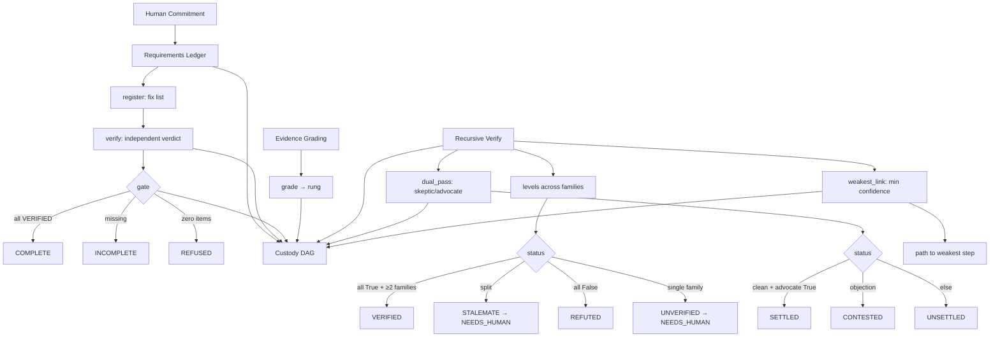

# vega-metacog-sdk — Architecture

## 1. The organism (family picture)

```
                 ┌──────────────────────────┐
                 │   THE HUMAN (the owner)  │  holds the only signing key;
                 │  authority starts here   │  spends it one action at a time
                 └────────────┬─────────────┘
                              v single-use signed commitments
 15 assemble   vega-umbrella-sdk        the family as one organism: one keyed
                                        ledger, one approval check, one anchor,
                                        registry + pre-deploy audit
 14 deliberate vega-council-sdk         multi-brain deliberation, design-first builder
               vega-galaxy-sdk          the galaxy view of the knowledge lattice:
                                        levels, convergence, futures above the present
 13 watch      vega-governance-feed-sdk  live view of every chain + tamper alarms
 12 verify >>> vega-metacog-sdk <<<     evidence rungs and the completion gate
 11 reason     vega-reasoning-sdk        fidelity, forecasting, routing: the lattice
                                        that predicts steps ahead
 10 observe    vega-trace-sdk            telemetry of reasoning: layer traces, entropy,
                                        harmonic echo, reference signature
  9 interface  vega-terminal-sdk         gated command execution for people and agents
  8 learn      vega-train-sdk            governed training + freeze cards: records
                                        exactly what a model learned from
  7 knowledge  vega-dkg-lattice-sdk      the knowledge graph: every fact with origin
                                        and licence; repo-library processing
  6 conduct    vega-harness-sdk          deterministic workflow conduct, pre-registered
                                        predicted paths, library use gate
  5 memory     vega-librarian-sdk        lessons and memory of past incidents
  4 contain    vega-two-gate-sdk         containment between two gates + the hard stop
  3 adapt      vega-pareah-sdk            adapters, cards, quarantine of inbound code:
                                        the dead-end room for the unannounced
  2 seal       vega-superproof-sdk       layered sealing and proof tiers
  1 authority  vega-governance-jacket-sdk human-only actions, single-use signed
                                        commitments, entry and exit gates
  0 record     vega-custody-sdk          capsules, DAG, hash-chained ledger, safe paths,
                                        bounded processes — the foundation everything
                                        writes to
```

**Layers below (what this SDK uses):** Layer 0 (custody) provides the append-only DAG for recording requirement registrations, verifications, gate checks, and evidence grades — hashes only, never content.

**Layers above (who consumes this):** Layer 11 (reasoning) uses evidence rungs to weight lattice confidence; layer 13 (governance-feed) watches gate outcomes; layer 15 (umbrella) registers this as the verify layer and wires it into the organism.

**One family, one organism:** Every SDK owns exactly one concern and uses the owner of every other concern instead of growing its own copy.

## 2. Internal drawing (ASCII)

```
                          AUTHORITY FLOW (down from human)
    ┌─────────────────────────────────────────────────────────────────┐
    │                     HUMAN DECISION                              │
    │  (single-use commitment via governance-jacket,                  │
    │   two-gate containment)                                         │
    └─────────────────────────┬───────────────────────────────────────┘
                              │
                              v
    ┌─────────────────────────────────────────────────────────────────┐
    │  REQUIREMENTS LEDGER (requirements.py)                          │
    │  Ledger.register()  ──► fixes requirement list                  │
    │       │                                                        │
    │       ▼ (first verify freezes list)                            │
    │  Ledger.verify()    ──► independent verifier, exact bool        │
    │       │                    author ≠ verifier for judged/human   │
    │       ▼                                                        │
    │  Ledger.gate()      ──► COMPLETE only if ALL VERIFIED           │
    │       │                    REFUSED if zero items                 │
    │       ▼                                                        │
    │  Every state change ► custody DAG (hashes only)                │
    └─────────────────────────┬───────────────────────────────────────┘
                              │
                              v
    ┌─────────────────────────────────────────────────────────────────┐
    │  EVIDENCE GRADING (evidence.py)                                 │
    │  grade(claim, sources, probe_receipt)                           │
    │       │                                                        │
    │       ▼                                                        │
    │  Rung: FACT / SINGLE_SOURCE / UNVERIFIED / RECALL_ONLY /        │
    │        ABSENCE_UNPROBED / ABSENCE_RECEIPT                       │
    │       │                                                        │
    │       ▼                                                        │
    │  Records rung hash ► custody DAG                               │
    └─────────────────────────┬───────────────────────────────────────┘
                              │
                              v
    ┌─────────────────────────────────────────────────────────────────┐
    │  RECURSIVE VERIFICATION (recursive.py)                          │
    │  recursive_verify(claim, verifiers[])                           │
    │       │                                                        │
    │       ▼ Level 0: judges claim                                   │
    │  Level N: sees prior verdicts (copy)                            │
    │       │                                                        │
    │       ▼ VERIFIED: all True + ≥2 families                        │
    │       ▼ STALEMATE: split → NEEDS_HUMAN                          │
    │       ▼ REFUTED: all False                                      │
    │       ▼ UNVERIFIED: single family / none answered               │
    │       │                                                        │
    │       ▼ dual_pass(claim, skeptic, advocate)                     │
    │       ▼ weakest_link(confidence_tree)                           │
    │       │                                                        │
    │       ▼ Records outcome ► custody DAG                          │
    └─────────────────────────┬───────────────────────────────────────┘
                              │
                              v
    ┌─────────────────────────────────────────────────────────────────┐
    │  CUSTODY DAG (vega-custody-sdk, layer 0)                        │
    │  Append-only, hash-chained, tamper-evident                      │
    │  Stores: REQ_REGISTER, REQ_VERIFY, REQ_REOPEN, REQ_GATE,        │
    │          evidence rung hashes, recursive outcomes               │
    └─────────────────────────────────────────────────────────────────┘

DATA/KNOWLEDGE FLOW (up from record):
custody records → librarian distils lessons → dkg-lattice builds graph
→ reasoning/galaxy forecasts → harness pre-registers predicted paths
→ metacog gates completion on evidence → feed/galaxy shows human
```

**Authority flow** (solid arrows down): Human commitment → jacket gates → contained execution → requirements ledger fixes list → independent verification → gate → record.
**Data flow** (dashed arrows up): Custody records → evidence rungs → recursive verification → confidence tree → human decision.

## 3. Mermaid diagram



## 4. Sequence: main scenario (end to end)

```
1. Human decides an action → signs single-use commitment (governance-jacket)
2. Caller creates Ledger(dag, author) with custody DAG
3. Caller registers requirements:
   Ledger.register("tests", "unit tests pass", "programmatic")
   Ledger.register("review", "code reviewed", "judged")
   Ledger.register("approval", "owner signs off", "human")
4. Work is performed (model reasons, code runs, etc.)
5. Verifiers run:
   Ledger.verify("tests", "ci", True)           # programmatic, author may run
   Ledger.verify("review", "reviewer", True)    # judged, author CANNOT run
   Ledger.verify("approval", "owner", True, kind_used="human")  # human only
6. Caller checks completion:
   Ledger.gate() → {"status": "COMPLETE", "missing": {}}
   If INCOMPLETE: missing dict shows what remains
7. Evidence grading on claims:
   evidence.grade("feature works", [src1, src2]) → {"rung": "FACT", ...}
   evidence.grade("bug does not exist", probe_receipt={...}) → {"rung": "ABSENCE_RECEIPT", ...}
8. Recursive verification on critical claims:
   recursive.recursive_verify("deployment safe", verifiers) → VERIFIED/STALEMATE/REFUTED
   recursive.dual_pass("deployment safe", skeptic, advocate) → SETTLED/CONTESTED/UNSETTLED
   recursive.weakest_link(confidence_tree) → {"confidence": 0.4, "path": ["top", "b"]}
9. All outcomes recorded to custody DAG (hashes only)
10. Human sees governance-feed view; decides next action
```

## 5. Trust boundaries

| Boundary | What changes hands | Enforcement |
|----------|-------------------|-------------|
| Human → Requirements Ledger | Single-use commitment authorizes the requirement list | Governance-jacket entry gate; ledger freezes list on first verify |
| Verifier → Ledger | Verdict (exactly True/False) | `verify()` rejects non-boolean; author independence enforced for judged/human kinds |
| Ledger → Custody DAG | State-change records (hashes only) | `dag.record()` called on every register/verify/reopen/gate; text never stored |
| Caller → Evidence grading | Sources + probe receipt | `grade()` validates shape; refuses malformed; absence claims require receipt |
| Evidence → Custody DAG | Rung hash | Caller records; SDK does not persist |
| Verifier fn → Recursive verify | {verdict, confidence} | Wrong shape or crash → abstain; cannot help pass |
| Recursive levels | Prior verdicts (copy) | `prior` passed as `[dict(p) for p in prior]` — verifier cannot mutate history |
| Skeptic/advocate → Dual pass | Objection list / exact True | Skeptic crash/wrong shape → UNSETTLED; any real objection → CONTESTED; advocate not exactly True → UNSETTLED |
| Confidence tree → Weakest link | Node confidences | Bounds enforced (depth 40, nodes 5000); parent = min(self, children) |
| This SDK → Family (umbrella) | Verify layer registration | Registry entry: `vega-metacog-sdk | 12 verify | custody`; no up/side imports |

## 6. Fail-closed constraint points (computational workflow)

```
HUMAN COMMITMENT
       │
       ▼
┌──────────────────┐
│ Ledger.register  │ ──► FAIL-CLOSED: refuses if frozen (after first verify),
│ (freeze on 1st   │      duplicate id, bad id/text/kind, >500 items
│  verify)         │      → LedgerRefused
└────────┬─────────┘
         │
         ▼
┌──────────────────┐
│ Ledger.verify    │ ──► FAIL-CLOSED: refuses non-boolean verdict,
│                  │      author verifying own judged/human,
│                  │      unknown requirement, bad verifier id,
│                  │      flipping VERIFIED → LedgerRefused
│                  │      3 failures → NEEDS_HUMAN (stalemate)
│                  │      NEEDS_HUMAN cannot reopen
└────────┬─────────┘
         │
         ▼
┌──────────────────┐
│ Ledger.gate()    │ ──► FAIL-CLOSED: REFUSED if zero requirements;
│                  │      INCOMPLETE if any not VERIFIED;
│                  │      never guesses COMPLETE
└────────┬─────────┘
         │
         ▼
┌──────────────────┐
│ evidence.grade() │ ──► FAIL-CLOSED: refuses empty claim,
│                  │      malformed source (wrong keys, non-bool checkable),
│                  │      >200 sources → EvidenceRefused
│                  │      absence claim without receipt → ABSENCE_UNPROBED rung
└────────┬─────────┘
         │
         ▼
┌──────────────────────┐
│ recursive_verify()   │ ──► FAIL-CLOSED: refuses <2 or >12 verifiers,
│                      │      duplicate ids, bad verifier shape
│                      │      crashing/wrong-shape verifiers → ABSTAIN
│                      │      split (True+False) → STALEMATE → NEEDS_HUMAN
│                      │      single family all True → UNVERIFIED
│                      │      none answered → UNVERIFIED → NEEDS_HUMAN
└────────┬─────────────┘
         │
         ▼
┌──────────────────┐
│ dual_pass()      │ ──► FAIL-CLOSED: refuses non-callable skeptic/advocate
│                  │      skeptic crash/wrong shape → UNSETTLED
│                  │      any real objection → CONTESTED (blocks)
│                  │      advocate not exactly True → UNSETTLED
└────────┬─────────┘
         │
         ▼
┌──────────────────┐
│ weakest_link()   │ ──► FAIL-CLOSED: refuses bad node shape,
│                  │      confidence outside [0,1], depth >40,
│                  │      nodes >5000 → RecursiveRefused
└────────┬─────────┘
         │
         ▼
   CUSTODY DAG
   (append-only, tamper-evident)
```

**Module + function for each fail-closed point:**
1. `evidence.grade()` — `evidence.py:42`
2. `Ledger.register()` — `requirements.py:38`
3. `Ledger.verify()` — `requirements.py:48`
4. `Ledger.gate()` — `requirements.py:79`
5. `recursive.recursive_verify()` — `recursive.py:28`
6. `recursive.dual_pass()` — `recursive.py:73`
7. `recursive.weakest_link()` — `recursive.py:93`
