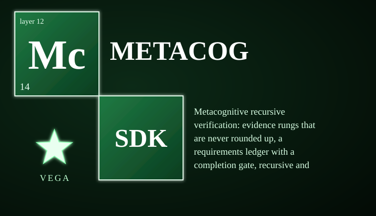

# vega-metacog-sdk

Metacognitive recursive verification: evidence rungs that are never rounded up, a requirements ledger with a completion gate, recursive and skeptic/advocate checking, and confidence capped by the weakest step.

> **Licensing.** Source-available, not open source. Free for personal use; free for registered small businesses (under US$1M revenue and valuation); everyone else needs a commercial license (see LICENSE; for a commercial license write to jasonblasiak.ai.mail@gmail.com). Patent pending. Draft licence text, not yet reviewed by an attorney.

Package: `vega_metacog` (src layout). Depends on: vega-custody-sdk.

## Modules

| Module | What it does |
|---|---|
| `evidence` | FACT needs two independent origins or a checkable commit; absence claims need a probe receipt. |
| `requirements` | Requirements fixed before judging; author cannot verify own judged work; repeated failure becomes a human stalemate. |
| `recursive` | Checkers checked by checkers across independent families; a split is a stalemate, never a vote; a weakest-link confidence tree. |

## What it does NOT do (read this)

- It grades the evidence it is given; it does not search or fetch anything.
- Independence is declared by the caller (families, origins); the repo cannot prove two verifiers are really independent.

## Status

See STATUS.md. Tests: 46 tests in 3 files, all passing.  See SECURITY.md for the threat model.

## Run the tests

Put `src` of this repo and of the repos it depends on on PYTHONPATH, then run each file in `tests/`.
